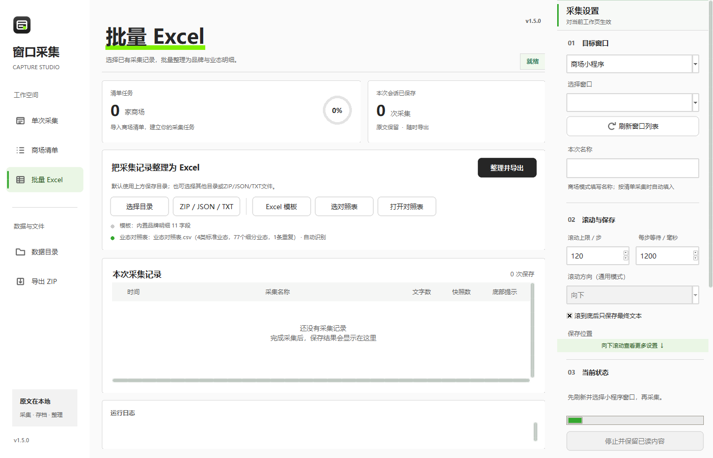
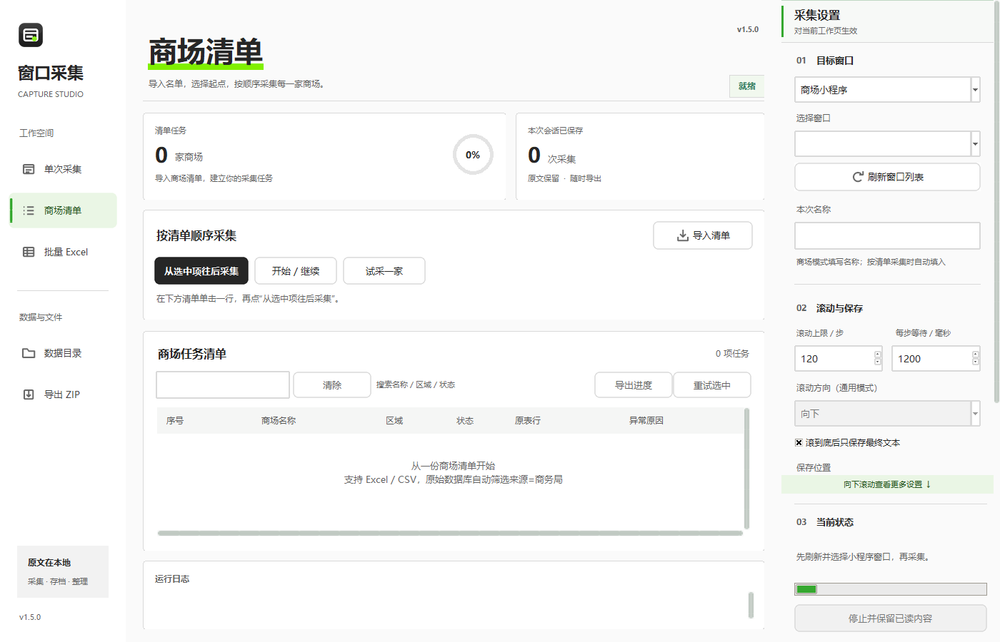

# 窗口文本采集器 Window Text Capture

> 一个只读 Windows 可访问性接口的窗口文本采集与整理工具：把小程序、浏览器或任意窗口里的
> 可见文字按快照存成可追溯的原文，再把商场商户列表批量整理成品牌业态明细 Excel。
> 本地运行，不做 OCR、不调用模型、不上传采集文本；会尝试保存窗口截图供核对。

[](https://github.com/TJH-1008/window-text-capture/actions/workflows/tests.yml)




## 它解决什么问题

要统计商场里有哪些品牌、各是什么业态，通常只能一屏屏刷小程序再手工誊抄。这个工具做三件事：

1. **采集**：读取前台窗口通过 UI Automation / MSAA 暴露的文本，自动向下滚动并逐屏保存快照；
   点击停止、失焦、到底提示都会中断，并如实标记“完整性未确认”。
2. **存档**：每次采集一个文件夹，原文、每次滚动快照、截图、底部状态全部留档，可回溯到原始页面文字。
3. **整理**：把多份采集记录批量转换成「品牌明细」Excel，附待复核记录、业态映射、业态待补清单和原始文本表。

## 亮点：业态对照表是配置，不是代码

标准业态（餐饮/零售/娱乐/配套…）**完全由表格决定**，改表即可换口径，不用改代码、不用重装：

- 支持 `CSV`（UTF-8 / UTF-8 BOM / GB18030 / UTF-16；逗号、分号、制表符；允许标题行）与 `XLSX`（任意工作表）；
  读 XLSX 只用标准库解析 OOXML，**不需要安装 Excel 或 openpyxl**。
- 自动识别：程序目录 → 输出目录 → 数据目录，同一位置取最后修改的那份；界面常显用的是哪份、自动识别还是手工指定。
- 两段式归并：平台原文（`面包蛋糕`、`瑜伽`、`量贩式KTV`）→ 标准细分业态 → 标准业态。
  表里没有的细分业态**不猜**，进“业态待补清单”并给出该补哪一行。
- 坏表不会拖垮整批：跳过无效文件 → 下一份可用表 → 内置四类业态，批次索引里写明跳过原因。

细节见 [docs/业态对照表.md](docs/业态对照表.md)。

| 平台原文 | 归并到的细分业态 | 标准业态 | 匹配方式 |
| --- | --- | --- | --- |
| 面包蛋糕 | 烘焙甜点 | 餐饮 | 内置别名 |
| 瑜伽 | 运动健身 | 配套 | 内置别名 |
| 量贩式KTV | KTV | 娱乐 | 内置别名 |
| 骨汤麻辣烫 | 小吃快餐/简餐 | 餐饮 | 内置关键词 |
| 智能按摩空间 | — | 其他/待复核 | 未匹配（设施，非品牌） |

## 三种工作模式

| 模式 | 用途 | 关键行为 |
| --- | --- | --- |
| 按商场清单采集 | 按一份 Excel/CSV 清单逐家采集 | 支持“从选中项往后采集”“重试选中项目”，断点写在 `采集数据/清单任务/` |
| 单次采集 | 手动滚到目标位置后采一次 | 不自动滚动，适合抽查或补采 |
| 通用窗口文本 | 浏览器、微信聊天、任意软件 | 保留沿途快照，禁用商场业态转换，避免误整理 |



## 快速开始

### 用发行包（推荐给使用者）

1. 到 [Releases](https://github.com/TJH-1008/window-text-capture/releases) 下载 `WindowCapture_<版本>_便携版.zip`，解压到有写权限的普通文件夹
   （不要直接在压缩包里双击运行）。
2. 双击 `启动采集器.cmd`。默认在程序所在目录的 `采集数据` 读写。
3. 采集：在微信里打开目标小程序页面 → 在工具里“刷新窗口”选目标窗口 → 填本次名称 → 采集。
4. 整理：切到“批量 Excel”页 → 选采集目录 → “整理并导出”。

### 用源码（推荐给开发者）

```powershell
git clone https://github.com/TJH-1008/window-text-capture.git
cd window-text-capture
python -m pip install -r requirements.txt
python app.py                         # 直接运行
```

要求：Windows 10/11 x64，Python 3.10+（带 tkinter），系统自带 PowerShell 5.1。

### 自行打包

```powershell
python -m pip install -r requirements-dev.txt
powershell -ExecutionPolicy Bypass -File build.ps1
# 产物：dist/WindowCapture_<版本>.exe
```

## 命令行也能用

```powershell
# 采集指定窗口一次（句柄取自窗口列表）
WindowCapture_1.5.0.exe --capture-window 123456 --profile general --label 测试页面 --output D:\采集数据

# 批量整理（不弹界面）
WindowCapture_1.5.0.exe --batch-import D:\采集数据\captures --excel-output D:\结果 --mapping 业态对照表.csv

# 启动自检，输出 JSON
WindowCapture_1.5.0.exe --smoke-test --smoke-report smoke.json
```

## 目录结构

```
app.py                 界面、采集进程、原始存档、批次导出入口
workspace_ui.py        OpenDesign 风格工作台（导航/卡片/表格/氛围层）
biz_mapping.py         业态对照表的发现、读取与匹配（纯标准库）
excel_import.py        商户列表解析、快照合并、xlsx 读写、批量转换
roster.py              清单导入（原始数据库筛选 / 普通 xlsx·csv）
batch_runner.py        清单任务调度、商场匹配、断点保存
capture_core.py        原文无损保存、路径处理、ZIP 导出
window_reader.ps1      UI Automation / MSAA 文本读取与滚动
window_navigation.ps1  前台保护下的文字定位、点击、输入、返回
assets/                图标与封面（由 build_assets.py 程序化生成）
Excel模板/             品牌明细 11 字段模板、空白清单模板、业态对照表 Excel 版
业态对照表.csv         默认业态对照表
docs/                  使用说明、业态对照表规则、设计约定、版本迭代、截图
```

## 开发与测试

```powershell
python -m unittest discover -p "test_*.py"      # 以本次测试输出为准
python verify_opendesign.py                     # 渲染三个工作区并截图到 verification-opendesign/
# 使用自有参考数据进行额外比对（需要四份指定项目样本，见脚本说明）
python verify_package.py --help
# 从已构建的 EXE 生成不含业务数据的便携包、升级包与 SHA256
python tools/package_release.py --exe dist/WindowCapture_1.5.0.exe
python tools/check_release.py                   # 发布前自查：数据残留、绝对路径、版本号、图标、发布包
```

CI 在 `windows-latest` 上跑同一套单元测试。测试覆盖：业态表各种编码/分隔符/坏文件、清单来源筛选、
快照合并边界、楼层与业态解析、导航状态机、界面控件可见性与 1100/1400 两档布局。

## 明确的边界

- 只读取**所选窗口**已加载、可访问的控件文字；图片、画布、折叠内容、未加载历史读不到。
- 清单模式会点击搜索框和列表入口、输入查询词、返回页面；不自动点击商户详情或发送消息。自动滚动会把目标窗口带到前台，失焦即暂停。
- 虚拟列表可能只保留末页文字；检测到“已经到底”也只代表候选文档含底部提示，**不等于**与主页数量核对过。
- 记录数不等于独立品牌数：同一品牌多楼层、多门店分别保留。
- 业态归并不做跨行业猜测，归不了的进待补清单，由人决定。
- 本项目及发行包不含真实采集数据、真实清单或业务数据库；首次使用请导入自己填写的空白清单模板。文档截图为无业务数据的界面演示。

## 隐私与合规

- 工具自身不调用在线模型或上传采集文本；目标微信、小程序或浏览器可能仍需联网加载页面。无需安装服务，删除程序文件夹即可移除程序，自选目录内的数据需单独管理。
- 采集到的文字保存在你指定的本地目录，请自行确认内容与授权范围；不要用本工具读取你无权获取的信息。
- 仅用于你本人有权访问的页面，并遵守目标平台的服务条款与当地法律。

## 变更记录

见 [CHANGELOG.md](CHANGELOG.md)：1.2.1 → 1.5.0 的功能演进，以及 1.5.0 为什么重写业态链路。

## 历史版本

提供的源码归档中只有 1.2.1、1.4.1-OpenDesign.2、1.5.0 三份快照；其他版本只有变更记录或打包配置。历史源码单独放在 Release 附件，见 [历史版本说明](docs/历史版本.md)。本仓库以 1.5.0 为当前基线。

## License

[MIT](LICENSE)
